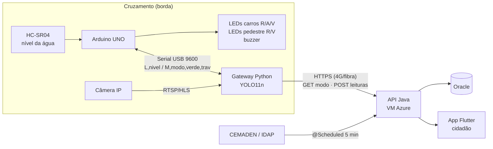
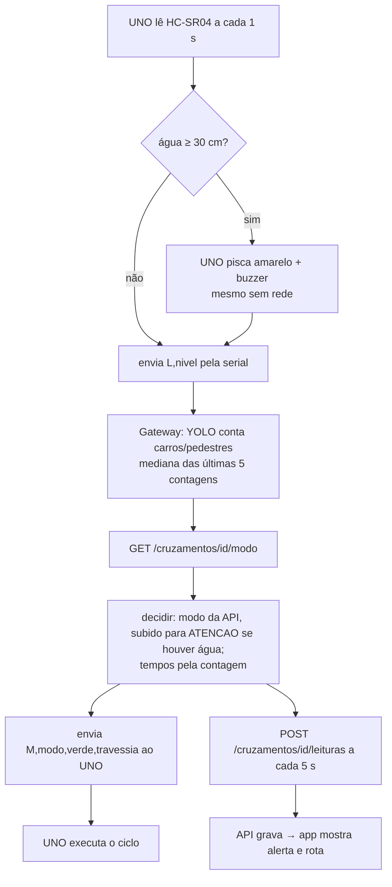
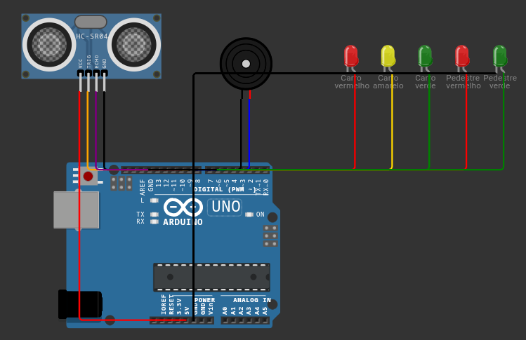

# SinalizaAI: semáforo com travessia inteligente e modo enchente

Global Solution 2026/2 · Disruptive Architectures: IoT, IoB & Generative IA

## Integrantes

| RM | Nome |
|---|---|
| RM566719 | Ruan Lima da Silva |
| RM568275 | Julia Valerio Guimarães da Silva |
| RM567549 | Rhayssa Graziano Bernardes e Rocha Ferreira |

## Problema e proposta

1. **Travessia que ignora quem atravessa.** Semáforos de tempo fixo dão o mesmo tempo com 1 ou 20 pedestres esperando, e abrem a travessia mesmo sem ninguém, segurando os carros à toa.
2. **Enchentes do El Niño.** O INMET prevê chuva acima da média no Sul entre novembro e janeiro. Ruas alagam e motoristas entram na água porque o semáforo continua em verde.

**Solução:** um cruzamento que **enxerga** (câmera com YOLO conta carros e pedestres), **mede** a água (HC-SR04) e **obedece à Defesa Civil** (modo vindo da API):

| Modo | Quando | Semáforo |
|---|---|---|
| `NORMAL` (0) | sem alerta | ciclo adaptativo: verde = `min(10 + 2·carros, 45)` s; travessia = `min(8 + pedestres, 25)` s, ou nenhuma travessia se não houver pedestres |
| `ATENCAO` (1) | água ≥ 30 cm **ou** alerta da API | amarelo piscante, pedestre vermelho; buzzer quando é enchente |
| `EVACUACAO` (2) | alerta da Defesa Civil | verde contínuo no sentido do abrigo (onda verde), pedestre vermelho |

**Privacidade:** a câmera só conta. Nenhum frame é guardado; a exceção é a evidência opcional `--snapshot`, e nela as pessoas saem borradas. Não há reconhecimento facial.

## Arquitetura



### Caminho dos dados



### Componentes de rede e justificativas

| Elemento | Escolha | Por quê |
|---|---|---|
| Sensor de água | HC-SR04 no poste, 2 m acima da via | Sem contato com a água, barato; nível = 200 − distância |
| Controlador | Arduino UNO | Exigência da disciplina; executa a regra de segurança localmente |
| UNO ↔ gateway | Serial USB 9600 bps | O UNO não tem rede; dentro do armário do poste o cabo é o meio mais confiável |
| Visão | YOLO11n no gateway (borda) | Mede **~115 ms por frame em CPU** (`evidencias/log_gateway.jsonl`); o vídeo não sai do poste, só os números |
| Câmera ↔ gateway | RTSP/HLS na LAN do poste (switch PoE) | Câmera IP padrão de prefeitura |
| Gateway ↔ nuvem | HTTPS sobre roteador 4G ou fibra municipal | Tráfego pequeno: um JSON por segundo e um POST a cada 5 s |
| Nuvem | API Java na VM Azure + Oracle | Mesma API do projeto (Java/DevOps); recebe alertas da CEMADEN |
| Produção sem PC | UNO + ESP-01 (Wi-Fi) ou shield Ethernet, usando MQTT | Só no diagrama: o Wokwi não simula esses módulos com UNO |

### Contrato

```
Serial UNO -> gateway   L,<nivelCm>\n                         a cada 1 s
Serial gateway -> UNO   M,<0|1|2>,<verdeSeg>,<travessiaSeg>\n  a cada 1 s
GET  /cruzamentos/{id}/modo      -> {"modo":"NORMAL|ATENCAO|EVACUACAO","verdeSeg":30}
POST /cruzamentos/{id}/leituras  <- {"nivelAguaCm":42,"carros":7,"pedestres":3}
POST /alertas                    <- {"modo":"EVACUACAO"}   (simulação pelo operador)
```

### Tolerância a falhas

- **Sem gateway por mais de 10 s:** o UNO volta sozinho ao ciclo fixo (20 s de verde, 10 s de travessia). A regra da enchente continua valendo.
- **API fora:** o gateway mantém o último modo recebido e continua decidindo os tempos localmente.
- **Sem câmera:** tempos fixos de 20 s e 10 s.
- **Comando inválido na serial:** é descartado. O UNO limita o verde a 5–90 s e a travessia a 0–40 s.

## Modelos e tecnologias

| Camada | Tecnologia | Uso |
|---|---|---|
| Hardware | Arduino UNO, HC-SR04, LEDs, buzzer | Semáforo e leitura do nível da água |
| Firmware | C++ (Arduino), `arduino-cli` | `sketch/sketch.ino` |
| Simulação | Wokwi (VS Code) | Circuito em `diagram.json`, serial exposta via RFC 2217 |
| Gateway | Python 3.10+, `pyserial` | Ponte serial ↔ HTTP e regra de decisão (`gateway.py`) |
| Visão computacional | YOLO11n (`ultralytics`), OpenCV | Contagem de carros e pedestres e borrão das pessoas (`visao.py`) |
| Vídeo | `yt-dlp` | Abre links de YouTube/HLS como câmera |
| Web UI | `http.server` (stdlib) | Visualização ao vivo (`ui.py`) |
| Nuvem | API Java (Spring Boot) na VM Azure + Oracle | Modos e leituras; `api_fake.py` a substitui nos testes |
| Testes | `unittest` | `test_gateway.py` |

**Por que YOLO11n:** é o menor modelo da família (5,4 MB) e roda em CPU a ~115 ms por frame, o que basta para contar a cada 2 s sem GPU no poste.

## Como executar

Pré-requisitos: VS Code com a extensão **Wokwi Simulator**, Arduino CLI (ou Arduino IDE) e Python 3.10+.

```bash
# 1. firmware
arduino-cli compile --fqbn arduino:avr:uno --output-dir build sketch

# 2. simulador: no VS Code, abra esta pasta → F1 → "Wokwi: Start Simulator"
#    (wokwi.toml expõe a serial em rfc2217://localhost:4000; deixe a aba do simulador visível)

# 3. gateway
cd gateway
python -m venv .venv && . .venv/bin/activate
pip install -r requirements.txt
python api_fake.py 8080 &        # ou aponte --api para a API Java na Azure
python gateway.py --serial rfc2217://localhost:4000 --api http://localhost:8080 \
                  --video amostras/person-bicycle-car-detection.mp4   # ou URL de câmera/YouTube ao vivo

# simular alerta da Defesa Civil
curl -X POST localhost:8080/alertas -d '{"modo":"EVACUACAO"}'
```

No Wokwi, clique no HC-SR04 e diminua a distância para menos de 170 cm (água acima de 30 cm): o semáforo passa a piscar em amarelo e o buzzer toca.

O modelo `yolo11n.pt` (5,4 MB) já vem no repositório em `gateway/`, então roda sem internet.

Para mostrar a visão ao vivo: `python ui.py` em `gateway/` e abrir http://localhost:8000 (vídeo com pessoas borradas, contagem e tempos).

## Testes e evidências

**Vídeo da demonstração:** [`evidencias/video-mostrando-funcionando.mp4`](evidencias/video-mostrando-funcionando.mp4) mostra o circuito no Wokwi e a web UI com a contagem, as pessoas borradas e os tempos calculados. O circuito também está em [`diagram.json`](diagram.json) (abre no Wokwi).



`cd gateway && python -m unittest -v` roda 7 testes:

| Caso | Esperado | Resultado |
|---|---|---|
| Tempos com 0 / 5 carros + 3 pedestres / 100 + 100 | (10,0) / (20,11) / (45,25), com teto | ok |
| Água em 29 cm e 30 cm | NORMAL / ATENCAO | ok |
| Água alta durante EVACUACAO | continua EVACUACAO | ok |
| Sem câmera e sem API | ciclo fixo (0,20,10) | ok |
| Modo desconhecido vindo da API | NORMAL | ok |
| Linhas seriais inválidas (`""`, `L,`, `L,abc`, `X,1`, `L,1,2`) | ignoradas | ok |
| Ponta a ponta: UNO falso em pty + API fake, alerta EVACUACAO + água 50 cm | UNO recebe `M,0,20,10` e depois `M,2,…`; leitura chega na API | ok |

**Execução com vídeo** (`evidencias/log_gateway.jsonl`, 30 s; vídeo público `gateway/amostras/person-bicycle-car-detection.mp4`, dos [sample-videos da Intel](https://github.com/intel-iot-devkit/sample-videos)). O UNO foi simulado em pty, com a água subindo de 10 para 45 cm aos 18 s, e o alerta EVACUACAO foi disparado aos 24 s:

| Fase | Comando enviado ao UNO |
|---|---|
| sem contagem ainda | `M,0,20,10` (ciclo fixo) |
| ninguém na faixa | `M,0,10,0`: não abre travessia |
| 1 pedestre detectado | `M,0,10,9` |
| água 45 cm | `M,1,10,0`: ATENCAO |
| alerta da API | `M,2,10,0`: EVACUACAO |

- Inferência YOLO11n em CPU: 110–117 ms por frame. Como a contagem roda a cada 2 s, sobra margem.
- `evidencias/snapshot_borrado.jpg` mostra o frame salvo com a pessoa borrada.
- Firmware: 7 132 bytes de flash (22%) e 256 bytes de RAM (12%) no UNO.

## Limitações

- O vídeo de amostra tem poucos carros. Para validar a contagem de veículos, use uma gravação de cruzamento real e compare com a contagem manual de 20 frames.
- A detecção perde precisão à noite, na chuva forte e com oclusão. A mediana de 5 contagens reduz o ruído, mas não resolve esses casos.
- O HC-SR04 sofre com espuma e objetos boiando. Em produção, um sensor ultrassônico IP67 ou de pressão seria mais adequado.
- Simulação: o UNO no Wokwi só fala com o gateway enquanto a aba do simulador está aberta; o ESP-01 e o shield Ethernet aparecem só no diagrama.
- Se a API cair durante uma EVACUACAO, o gateway mantém esse modo até a API voltar.
